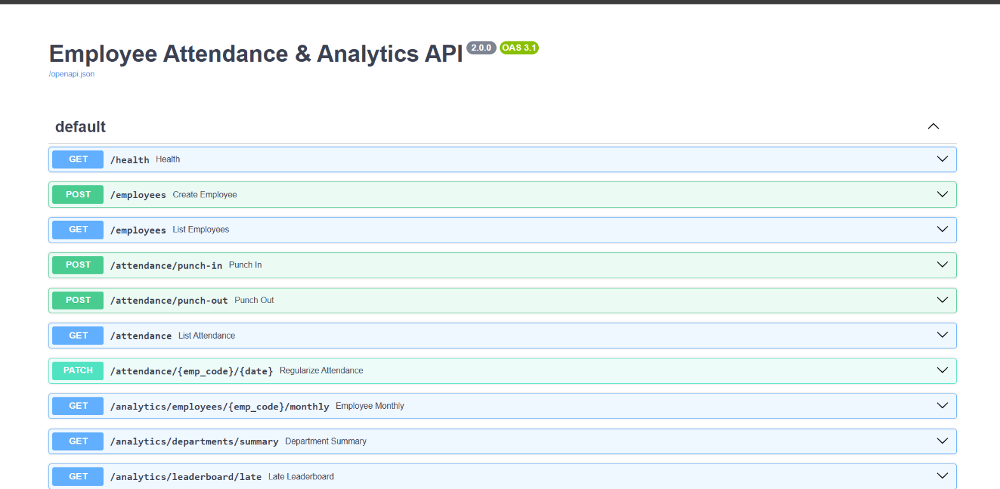
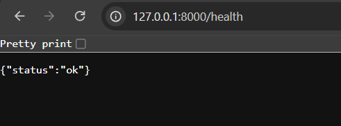
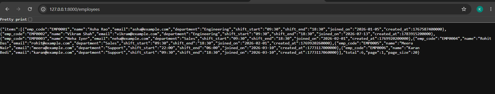
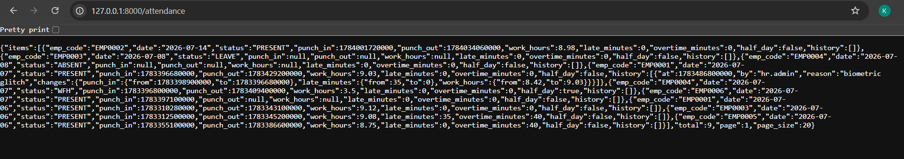

# Employee Attendance & Analytics API

FastAPI + MongoDB service for employee punch-in/out, audited corrections, monthly and department analytics, a daily trend, and an explain endpoint. All code is in `app/main.py`. Indexes are created automatically at startup.

## Run

You need Python 3.11+ and MongoDB 6.0+ (local, or a free Atlas cluster).

```powershell
py -m pip install -r requirements.txt
$env:MONGO_URI = "mongodb://localhost:27017"
$env:MONGO_DB  = "attendance_db"
py -m uvicorn app.main:app --port 8000
```

Then open http://localhost:8000/docs. `GET /health` should return `{"status":"ok"}`.

A quick local MongoDB: `docker run -d --name mongo -p 27017:27017 mongo:7`. For Atlas, use your `mongodb+srv://...` string as `MONGO_URI`.

`MONGO_URI` and `MONGO_DB` come from the environment (a local `.env` also works, but real environment variables win). Nothing is hard-coded.

## Working proof

The app running locally on port 8000 against MongoDB Atlas with the sample data loaded.

API docs (`/docs`):



`GET /health`:



`GET /employees`:



`GET /attendance`:



## Notes

- Everything in the contract is implemented; nothing is missing.
- I tested against Atlas with a generated dataset of about 87,000 records (mid-month joiners, overnight shifts, ties, employees with no logs, weekend records), comparing results with an independent calculation. I did not have the hidden dataset.
- `attendance_pct` is rounded to 2 decimals (R8); `attendance_rate` and `moving_avg_7d` to 4.
